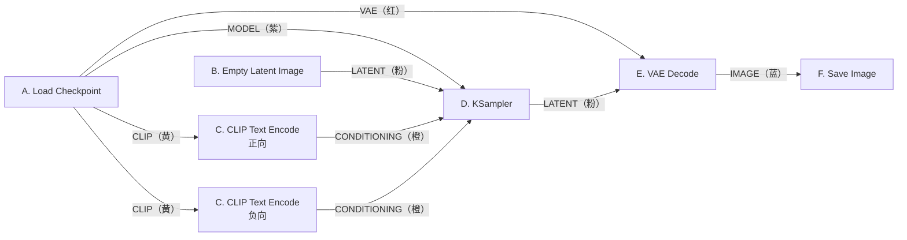
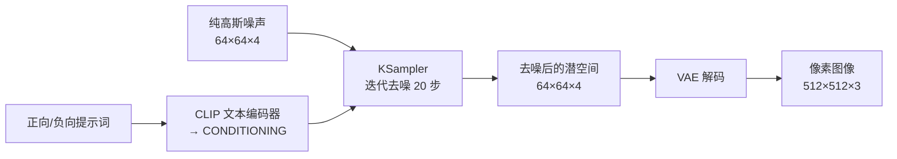
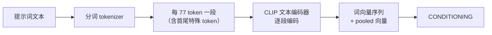

import InteractiveWorkflow from '@site/src/components/InteractiveWorkflow';

# ComfyUI 文生图：从第一张图到每个参数

> 本课以 SD1.5 示例工作流为样板，带你完整走一遍文生图：先照着做出一张图，再弄清六个节点各做什么、KSampler 的每个参数怎么调，最后学会复现与排错。所有步骤都可以直接照做。

## 本课目标

学完这一课，你应该能够：

- 在十分钟内跑出第一张图，并知道图片存到了哪里；
- 说清 MODEL、CLIP、CONDITIONING、LATENT、VAE、IMAGE 六种连线分别代表什么；
- 理解 seed、steps、cfg、sampler、scheduler、denoise 的作用，并按需调整；
- 写出结构清晰的提示词，正确使用权重和负向提示词；
- 遇到模型为空、黑图、显存不足、结果无法复现时，能自己排查。

## 课前准备

- 已经安装好 ComfyUI，能打开界面。
- 已下载一个 SD1.5 模型文件（本课使用 [v1-5-pruned-emaonly-fp16.safetensors](https://huggingface.co/Comfy-Org/stable-diffusion-v1-5-archive/blob/main/v1-5-pruned-emaonly-fp16.safetensors)，约 2.1 GB）。
- 首次运行需要把模型从磁盘加载进显存，请预留几分钟时间。

> **版本说明**
> 本课截图使用 ComfyUI 0.4x。不同版本按钮文字略有差异，例如执行按钮可能叫「队列 / Queue」，也可能叫「Run / 运行」，功能相同。
> 另外，不同版本启动时默认打开的工作流可能不一样。本课请按第 1.2 节加载示例工作流，界面就会和截图一致。

## 一、十分钟跑通第一张图

### 1.1 放好模型

模型要放进 ComfyUI 的 `models/checkpoints` 文件夹：

- 便携版：`ComfyUI_windows_portable/ComfyUI/models/checkpoints/`
- 桌面版：在菜单里选择 **帮助 → 打开文件夹 → 打开模型文件夹**，再进入 `models/checkpoints`
- 手动安装：`ComfyUI/models/checkpoints/`

放好之后回到界面，按键盘 `R` 刷新节点定义，或者重启 ComfyUI。

然后点开 `Load Checkpoint` 节点里的下拉框，应该能看到 `v1-5-pruned-emaonly-fp16.safetensors`。

> **注意：下拉框是空的或显示 null 怎么办？**
> 依次检查：文件是否真的在 `models/checkpoints` 下；后缀是不是 ComfyUI 支持的格式（推荐 `.safetensors`）；放好后是否按了 `R` 刷新；文件是否下载完整。四项都没问题，重启一次 ComfyUI 就能看到。

**模型文件怎么选**

| 文件 | 大小 | 说明 |
| ---- | ---- | ---- |
| `v1-5-pruned-emaonly-fp16.safetensors` | 约 2.1 GB | 本课使用；推理用 fp16，加载快、显存占用低 |
| 原始 fp32 版 SD1.5 | 约 4 GB | 精度更高，但对出图效果影响很小，入门不必追求 |
| 社区模型（如 Dreamshaper、Anything V5） | 约 2–4 GB | 风格不同，用法完全一样 |

文件名的三个词说明它的来历：`pruned` 去掉了推理用不到的训练状态，`emaonly` 只保留 EMA 权重，`fp16` 表示半精度。它们让文件从约 4 GB 缩小到约 2.1 GB，出图效果几乎不变。

优先使用 `.safetensors` 格式：它只存张量数据，加载更快，也不执行额外代码。早期的 `.ckpt` 格式来源不明时不要加载。

### 1.2 加载示例工作流

有三种方式，任选一种：

1. **拖入图片**：把[这张示例图](https://raw.githubusercontent.com/Comfy-Org/example_workflows/refs/heads/main/image/basic/text-to-image-workflow.png)下载后，直接拖进 ComfyUI 画布。
2. **菜单打开**：菜单 **工作流（Workflows）→ 打开（Open）**，选择 `.png` 或 `.json` 文件，快捷键 `Ctrl/Cmd + O`。
3. **示例浏览器**：菜单 **工作流 → 浏览示例工作流（Browse example workflows）**，选择 **Text to Image**。

加载成功后，画布上会出现六个节点。先在下面的交互实验室里熟悉它：拖动节点和画布、点击端口与连线、修改任意参数，下方讲解会同步更新。点击「模拟运行」还可以观察执行顺序。

<InteractiveWorkflow />

<details>
<summary>查看原始工作流截图</summary>


</details>

> **为什么一张图片能变成工作流？**
> 示例图本身是一张生成好的 512×512 成品图，PNG 文件里额外保存了两段数据：一段是界面用的工作流结构，一段是执行用的节点参数。ComfyUI 读取这两段数据，就能把节点、连线和参数原样还原。
> 所以，**只有原始 PNG 才能还原工作流**。经过截图、聊天软件转发或网页压缩之后，这些数据会丢失。
> 同理，你自己生成的每一张 PNG 也都带着工作流，随时可以拖回来复现。只想分享工作流时，用菜单 **工作流 → 导出（Export）** 存成 `.json`。

### 1.3 核对关键参数

加载后先照着下表核对一遍。这一步能避免绝大多数「跑出来不对」的问题。

| 节点 | 参数 | 应该是什么 |
| ---- | ---- | ---------- |
| Load Checkpoint | 模型 | `v1-5-pruned-emaonly-fp16.safetensors` |
| Empty Latent Image | width / height | `512 / 512` |
| CLIP Text Encode（上） | 正向提示词 | `beautiful scenery nature glass bottle landscape, , purple galaxy bottle,` |
| CLIP Text Encode（下） | 负向提示词 | `text, watermark` |
| KSampler | seed 模式 | `randomize`（可先不改） |
| KSampler | steps / cfg | `20 / 8.0` |
| KSampler | sampler / scheduler | `euler / normal` |
| KSampler | denoise | `1.0` |
| Save Image | filename_prefix | `ComfyUI` |


> **注意：自己新建 Empty Latent Image 时要改尺寸。**
> 新版本里这个节点的默认值是 1024×1024。SD1.5 在 1024 下容易出现重复肢体、双头等崩坏，配 SD1.5 时请手动改成 512×512。

### 1.4 生成并保存第一张图

1. 确认 `Load Checkpoint` 里选中的是 `v1-5-pruned-emaonly-fp16.safetensors`，左右切换不会出现 `null`。
2. 点右上角的 **队列 / Queue**（部分版本显示为 **Run**），或按 `Ctrl/Cmd + Enter`。
3. 执行时，正在运行的节点会高亮；KSampler 节点里会逐步显示一张小预览图，用来观察进度。
4. 完成后，`Save Image` 节点里出现成品图，右键即可保存到本地。


如果一切正常，你应该看到一只装着紫色星河的玻璃瓶，背景是绿色树林。因为 seed 模式是 `randomize`，每次的构图会有差别；只要主体、色调和清晰度接近，就说明流程已经跑通。

**图片存在哪里**

`Save Image` 在出图时已经把文件写进 `ComfyUI/output/`，节点里的预览只是顺手展示。文件名规则是：

```text
前缀_00001_.png
```

编号从 1 开始，5 位补零，自动接续目录里已有的最大值；前缀可以在节点上改，也可以写成 `子目录/前缀` 来分文件夹。前缀支持 `%width%`、`%height%`、`%year%`、`%month%`、`%day%` 等变量。

> **小技巧：为什么第二次点队列会「秒出」？**
> 如果所有输入都没变（尤其是把 seed 固定成 `fixed`），ComfyUI 会直接复用上次的执行结果，看起来瞬间完成。这不代表模型真的又跑了一遍。想观察完整耗时，把 seed 模式改成 `randomize`，或改动任意参数。

### 1.5 让结果可以复现

第一次运行时结果每次都不同，是因为 KSampler 的 seed 模式是 `randomize`：每次执行前，前端会把 seed 换成一个新的随机值。

把 seed 左侧的模式改成 `fixed`，seed 就会保持不变，生成的图也能稳定复现。

seed 的四种模式：

| 模式 | 作用 |
| ---- | ---- |
| `fixed` | 保持不变，调试、复现、对比参数时使用 |
| `increment` | 每次执行后加 1 |
| `decrement` | 每次执行后减 1 |
| `randomize` | 每次执行前换成随机值，适合连续出不同方案 |

> **想复现一张图，只记住 seed 是不够的。**
> 还需要保持模型文件、steps、cfg、sampler、scheduler、分辨率、denoise 完全一致。ComfyUI、PyTorch 或显卡驱动升级后，旧 seed 也可能得到略有差异的结果。最稳妥的复现方式，是直接保留带工作流的原始 PNG，或用 **工作流 → 导出** 存档 JSON。

到这里，第一张图就完成了。接下来我们回头看：这台「造图机器」到底由哪些零件组成。

## 二、看懂这台造图机器：六个节点

### 2.1 数据如何流动

六个节点、六种连线，构成一条单向流水线：



ComfyUI 用颜色区分数据类型，**同色才能相连**。六种类型分别是：

| 类型 | 颜色 | 代表什么 | 由谁输出 |
| ---- | ---- | -------- | -------- |
| `MODEL` | 紫 | 去噪用的扩散模型（UNet） | Load Checkpoint |
| `CLIP` | 黄 | 文本编码器 | Load Checkpoint |
| `CONDITIONING` | 橙 | 编码后的文本条件 | CLIP Text Encode |
| `LATENT` | 粉 | 潜空间里的图像 | Empty Latent Image / KSampler |
| `VAE` | 红 | 潜空间与像素空间的编解码器 | Load Checkpoint |
| `IMAGE` | 蓝 | 像素图像 | VAE Decode |

六个节点分工如下：

| 节点 | 一句话作用 | 输出 | 阅读顺序 |
| ---- | ---------- | ---- | -------- |
| A. Load Checkpoint | 加载模型，拆出三件套 | MODEL、CLIP、VAE | 先看输出 |
| B. Empty Latent Image | 定义画布尺寸和批量 | LATENT | 先看输出 |
| C. CLIP Text Encode | 把提示词变成条件 | CONDITIONING | 先看输入 |
| D. KSampler | 反复去噪，生成潜空间图像 | LATENT | 核心 |
| E. VAE Decode | 把潜空间还原成像素图 | IMAGE | 先看输入 |
| F. Save Image | 保存成品 | 无（输出节点） | 终点 |

读工作流的习惯是：**从 Save Image 往前倒推**。要存图，就需要 IMAGE；要 IMAGE，就需要 VAE Decode；要解码，就需要 LATENT 和 VAE……顺着连线一路往前，整条链路自然就清楚了。

### 2.2 从噪声到图像：扩散与潜空间

文生图的核心是**扩散模型**。它在一张张「加了噪声的图片」上训练，学会了判断「这张图里哪些是噪声」。生成时反过来用：先给一张纯噪声，让模型反复预测并去掉噪声，几十轮之后，画面就从噪声里「显影」出来了。



**为什么画布不是 512×512 像素？**

因为扩散发生在**潜空间**里，而不是像素空间。以 512×512 为例：

| 空间 | 数据形状 | 数值量 | 谁在处理 |
| ---- | -------- | ------ | -------- |
| 像素空间 | 512×512×3 | 约 78.6 万个 | VAE 解码后的最终图像 |
| 潜空间 | 64×64×4 | 约 1.6 万个 | UNet 去噪 |

像素尺寸除以 8 得到潜空间尺寸：512 对应 64，768 对应 96，1024 对应 128。这个 8 来自 VAE 的三次 2 倍下采样（2³ = 8）。潜空间只有 4 个抽象通道，不是 RGB；颜色要等 VAE 解码后才回来。

在潜空间里做 20 步扩散，计算量比直接在像素上做小几十倍，这正是 Stable Diffusion 能在消费级显卡上运行的原因。

**Empty Latent Image 到底给了什么？**

它输出一张**全零的空白底片**，形状是 `[batch, 4, 高/8, 宽/8]`，并告诉下游「像素到潜空间的缩放比例是 8」。

噪声不在这个节点里。KSampler 拿到这张空白底片后，才根据 seed 生成噪声、加到底片上，然后开始去噪。可以把它理解成一张还没曝光的底片：尺寸和通道已经定好，画面内容由后续的采样过程决定。

**为什么宽高必须是 8 的倍数？**

因为像素尺寸要除以 8 才能得到整数潜空间尺寸。不是 8 的倍数时，程序会向下取整，输出尺寸可能比你填的小。例如 513 会得到 512。

### 2.3 A. Load Checkpoint（加载模型）


**输入**：`ckpt_name`，即 `models/checkpoints` 里检测到的模型列表。

**输出**：三条线，对应 checkpoint 里的三个组件。

| 输出 | 类型 | 接到哪里 | 作用 |
| ---- | ---- | -------- | ---- |
| MODEL | 紫 | KSampler.model | UNet，去噪时预测噪声 |
| CLIP | 黄 | 两个 CLIP Text Encode.clip | 文本编码器，把提示词变成条件 |
| VAE | 红 | VAE Decode.vae | 潜空间与像素空间互转 |

SD1.5 的 checkpoint 是一个打包文件，同时装着 UNet、CLIP 文本编码器和 VAE，所以整条工作流只需要一个加载节点。换成 Flux 等新架构时，这三部分往往拆成多个文件，需要分别加载。

加载时，ComfyUI 会读取文件、识别架构，再把三个模型对象准备好。模型真正被采样调用时才搬到计算设备；同一份模型被多个节点引用时不会重复加载。

**选择模型时注意**

- 这个六节点工作流是给 SD1.5 用的。换成 SDXL、SD3、Flux 等模型时，尺寸、提示词和节点结构都要跟着换，优先使用对应的示例工作流。
- 不要把 LoRA、VAE 之类的文件放进 `checkpoints`，它们有各自的文件夹和加载节点。
- 模型文件下载不完整时，加载会直接报解析错误。

### 2.4 B. Empty Latent Image（空 Latent 图像）


**输入**：`width`、`height`（像素，步长 8，最小 16）、`batch_size`（1–4096）。

**输出**：一个 LATENT，内部是 `samples`（全零张量）和缩放比例标记。

**三个参数的含义**

- **width / height**：最终像素尺寸。512 生成 64×64 的潜空间，768 生成 96×96，1024 生成 128×128。
- **batch_size**：一次采样同时生成几张。四张图共享同一组参数，但初始噪声不同，所以会得到一组风格相近、细节不同的图。

**SD1.5 的推荐尺寸**

| 用途 | 尺寸 | 说明 |
| ---- | ---- | ---- |
| 默认方图 | 512×512 | 训练分辨率，最稳 |
| 竖图 | 512×768 | 常见人像比例 |
| 横图 | 768×512 | 常见风景比例 |
| 接近方图 | 640×640 | 可以尝试，边缘容易变异 |
| 直接大图 | 1024×1024 | 不建议；容易出现重复肢体、构图崩坏 |

> **注意：新版本节点默认是 1024×1024。**
> 加载示例工作流不受影响，因为示例里保存的是 512。但如果你自己新建一个 Empty Latent Image 配 SD1.5，记得先改回 512。

**换用其他模型时**：如果潜空间是全零的空白底片，ComfyUI 会根据目标模型的格式自动补齐通道和缩放比例，所以这个节点在 SD3、Flux 等模型上也能使用。但尺寸、训练分辨率和文本编码器仍要按模型来，不能只靠节点兜底。

### 2.5 C. CLIP Text Encode（提示词编码）


**输入**：`text`（多行提示词）、`clip`（来自 Load Checkpoint 的黄色线）。

**输出**：`CONDITIONING`，供 KSampler 的正向和负向输入使用。

示例工作流里有两个同样的节点：上面一个接 `positive`，写你希望在画面中出现的内容；下面一个接 `negative`，写你不希望出现的内容。

> **注意：正负节点不要接反。**
> 接反不会报错，但画面会「避着你要的东西画」。如果结果总是很奇怪，先检查这两条橙色线有没有接错。

**文本是怎么变成条件的**



- SD1.5 使用 CLIP ViT-L/14 文本编码器，输出 768 维向量。
- 文本编码在采样开始前做一次，KSampler 的每一步都复用这份条件。
- 因此提示词越复杂，编码开销越大；但相比 20 步采样，编码本身通常很快。

**提示词的几个实用规则**

- 用英文。SD1.5 的 CLIP 只熟悉英文语料。
- 用逗号分隔短语，例如 `1girl, pink hair, cherry blossoms`，比长句更可控。
- 把主体和风格放在前面。
- 权重用圆括号表示，具体写法见 4.2。
- 还支持 `embedding:name` 引用 `models/embeddings` 里的嵌入，属于进阶用法。

### 2.6 D. KSampler（K 采样器）

KSampler 是整条流水线里真正执行去噪的节点，也是参数最多、最值得研究的节点。


它接收四路输入：

| 输入 | 来源 | 作用 |
| ---- | ---- | ---- |
| model | Load Checkpoint 的紫色线 | 去噪模型 |
| positive | 正向 CLIP Text Encode | 希望出现的特征 |
| negative | 负向 CLIP Text Encode | 不希望出现的特征 |
| latent_image | Empty Latent Image | 空白底片，提供尺寸与批量 |

输出一份 LATENT，交给 VAE Decode。

它的六个参数——seed、steps、cfg、sampler_name、scheduler、denoise——将在第三节逐个讲透。

### 2.7 E. VAE Decode（VAE 解码）


**输入**：`samples`（KSampler 输出的 LATENT）、`vae`（来自 Load Checkpoint 的红色线）。

**输出**：`IMAGE`，形状 `[batch, 高, 宽, 3]`，数值范围 0–1；Save Image 再把它转换成 0–255 的 PNG。

VAE 是潜空间和像素空间之间的翻译器。解码之后，我们才能真正看到画面。

**注意**

- 外挂 VAE 必须和模型架构匹配，SD1.5 的 VAE 不能给 SDXL 用，反之亦然。
- 默认情况下，ComfyUI 会根据显卡选择 bf16 或 fp32 计算 VAE。如果强制使用 `--fp16-vae`，部分 VAE 会因数值溢出出现黑图或花屏，遇到时去掉这个启动参数。
- 大图解码显存不够时，可以改用 `VAE Decode (Tiled)` 分块解码。

### 2.8 F. Save Image（保存图像）


**输入**：`images`（IMAGE）、`filename_prefix`（默认 `ComfyUI`）。

**输出**：作为输出节点触发保存，同时把结果显示在界面里。

保存时会做两件事：

1. 把图片写入 `ComfyUI/output/`，文件名按 1.4 节的规则递增。
2. 把 `prompt`（执行用的节点参数）和 `workflow`（界面用的工作流）写进 PNG 的元数据。

所以，分享一张原图，等于同时分享了提示词、模型名和全部参数；如果不希望公开，可以在启动时加 `--disable-metadata`，或者只发截图。

调试阶段也可以使用 `Preview Image` 节点：它把图写到临时目录，不进入 output 文件夹，适合频繁试参数时使用。

## 三、KSampler 参数逐个讲

### 3.1 seed：决定从哪一张噪声开始

seed 是一个 64 位整数，范围 0 到 18446744073709551615，默认 0。它决定初始噪声的样子，也就决定了生成的起点。

- **想复现**：把 mode 改成 `fixed`，保持 seed 不变。
- **想连续出不同方案**：用 `randomize`。
- **想批量编号**：用 `increment` 或 `decrement`。

**复现一张图需要同时满足**

1. 同一个模型文件。
2. 相同的 seed、steps、cfg、sampler、scheduler、denoise。
3. 相同的分辨率与 batch。
4. 相同版本的 ComfyUI、PyTorch 和显卡驱动。
5. 相同的硬件与精度路径。

前三条完全由你控制；后两条决定了为什么「抄了参数还是差一点」。

**seed 和 batch 的关系**

batch 为 4 时，四张图共享同一个 seed，但噪声会在 batch 维上分成四份，所以四张图不同。连续点四次队列（`randomize`）则是换了四个 seed，属于四次独立采样，不是同一批。

### 3.2 steps：去噪分几步走

steps 表示把去噪过程拆成多少步，默认 20。每一步都要调用一次模型；cfg 大于 1 时，正向和负向条件会拼成一个 batch 一起计算，单步计算量约等于两次前向。

所以，示例工作流中 20 步、cfg 8，实际计算量约等于 40 次前向。

| steps | 效果 |
| ----- | ---- |
| 1–8 | 只有大致构图，细节很少 |
| 10–15 | 能用，但质感和细节偏弱 |
| 20–30 | SD1.5 的常用区间，示例使用 20 |
| 40 以上 | 收益迅速递减，只是更慢 |

不同采样器的有效步数不同：euler 在 20–30 步比较稳定，dpmpp_2m 这类二阶方法通常 20–25 步就够。先用 20 步把提示词调好，再考虑加步数。

### 3.3 cfg：提示词引导强度

cfg 是 Classifier-Free Guidance 的缩放系数，默认 8.0，范围 0–100。它控制生成结果有多大程度贴合提示词。

```text
输出 = 负向预测 + (正向预测 - 负向预测) × cfg
```

- **cfg = 1**：输出等于正向预测，ComfyUI 会跳过负向分支。此时负向提示词完全不起作用，速度也更快。
- **cfg 偏大**：更贴近提示词，但容易出现高对比、过饱和、结构僵硬、颜色失真。
- **cfg 偏小**：模型更自由，构图更有创意，但更容易跑题。

SD1.5 的常用区间是 6–8。低于 5 容易跑偏，高于 10 画面很快开始「烧」。

如果你写了很多负向提示词却感觉没用，先检查 cfg 是不是太低了。

### 3.4 sampler_name：每一步怎么走

采样器决定每一步如何利用模型预测来更新潜空间，是「走路的方式」，不是「走多少步」。

常见采样器：

| 类型 | 代表 | 特点 |
| ---- | ---- | ---- |
| 一阶欧拉 | `euler` | 示例所用；稳定、快，SD1.5 的万金油 |
| 祖先欧拉 | `euler_ancestral` | 每步额外注入随机噪声，画面更有灵气，也更随机 |
| 二阶方法 | `heun`、`dpm_2` | 每步计算更多，步数需求更低 |
| DPM++ 系列 | `dpmpp_2m`、`dpmpp_2m_sde`、`dpmpp_3m_sde` | 社区常用，细节与稳定性平衡好 |
| SDE 系列 | `dpmpp_sde`、`dpmpp_2m_sde` | 带随机性，结果更有变化 |
| 快速/兼容 | `lcm`、`ddim`、`uni_pc` | lcm 需要配套的 LCM 模型；其余可用于兼容旧工作流 |

当前版本提供了 40 多个采样器，不必全部记住。初学时固定 `euler`，把提示词和参数调好；之后可以试 `dpmpp_2m + karras`、`euler_ancestral + normal` 对比风格。

**祖先采样器与复现**

`euler_ancestral` 每一步都会注入新的随机噪声。这个噪声同样由 seed 决定，所以在相同 seed、相同步数下仍可复现。但**改变 steps 会改变每一步注入噪声的序列**，因此 20 步和 30 步即使 seed 相同，也不是同一张图。

### 3.5 scheduler：每一步用多大的噪声

调度器决定整个去噪过程的「降温曲线」，即每一步从多大的噪声开始。采样器负责更新公式，调度器负责每一步的噪声大小，两者是正交的。

| 调度器 | 特点 |
| ------ | ---- |
| `normal` | 均匀线性，示例所用，最通用 |
| `karras` | 低噪声段更密集，细节更好，常配 DPM++ |
| `exponential` | 指数衰减，变化更平滑 |
| `sgm_uniform` | 类似 normal 的均匀分布，适配部分新模型 |
| `simple` | 按 sigma 均分，行为直接 |
| `ddim_uniform` | 均匀步长的变体 |
| `beta` | 基于 beta 分布的调度 |
| `linear_quadratic` | 二次曲线式衰减 |
| `kl_optimal` | 较新的调度方式 |

常用组合：

| 组合 | 适合 |
| ---- | ---- |
| `euler + normal` | 示例配置，入门首选 |
| `dpmpp_2m + karras` | SD1.5 通用，细节和稳定性平衡 |
| `dpmpp_2m_sde + karras` | 想要更多随机变化 |
| `euler_ancestral + normal` | 想要更「活」的画面 |
| `uni_pc + simple` | 少步数下也有不错效果 |

### 3.6 denoise：从哪里开始去噪

denoise 表示从噪声日程的哪个位置开始，范围 0–1，默认 1.0。

- **1.0**：从纯噪声开始，文生图必须用这个值。
- **小于 1**：从更低噪声的位置开始，保留更多输入 latent 的结构。这是图生图、局部重绘、二次采样的核心参数。

文生图的输入是全零的空白底片，没有结构可以保留。把 denoise 调低，等于跳过前面的去噪阶段，结果通常发灰、发糊、细节残缺。这不是「微调文生图」的正确方式；正确做法是先出底图，再走图生图或放大流程。

> **denoise 的精确行为**
> 它并不是「往 latent 里加多少噪声」，而是控制从噪声日程的哪个位置起步。实现上会先计算一条更长的 sigma 序列，再取尾部 `steps + 1` 个点，所以滑块写 20 步，实际模型调用次数仍是 20 次。denoise 设为 0 时，采样器直接返回输入 latent。

### 3.7 latent_image、输出与预览

`latent_image` 接收 Empty Latent Image 的 LATENT，用来确定画布尺寸、batch 和通道。输出同样是一份 LATENT，交给 VAE Decode。

采样过程中，KSampler 节点里显示的预览图是**低分辨率快速预览**，由 TAESD 或 Latent2RGB 近似解码得到。它的颜色和细节可能和最终成品不同，判断结果请以 Save Image 里的图为准。

### 3.8 KSamplerAdvanced：需要更细控制时

入门阶段只用 KSampler 就够了。当你需要「先采样一部分，再换条件继续」时，可以使用 `KSamplerAdvanced`。它多出这些参数：

| 参数 | 作用 |
| ---- | ---- |
| add_noise | 是否添加初始噪声 |
| start_at_step / end_at_step | 从第几步开始、到第几步结束 |
| return_with_leftover_noise | 是否保留剩余噪声，便于交给下一段采样 |

它和 KSampler 共用同一套采样内核，只是把中间过程暴露出来。

## 四、提示词与画质

### 4.1 提示词的结构

一个够用的结构是：

```text
主体 + 动作/姿态 + 环境 + 风格 + 光线 + 镜头/画质
```

**写实人像示例**

```text
(ultra realistic portrait:1.2), elegant woman in crimson silk dress, full body,
soft cinematic lighting, (golden hour:1.1), shallow depth of field,
film grain, warm color grading
```

负向：

```text
low quality, blurry, deformed hands, extra fingers, watermark, text
```

**二次元示例**

```text
anime style, 1girl with long pink hair, cherry blossom background,
soft lighting, intricate details
```

负向：

```text
low quality, blurry, deformed hands, extra fingers
```

几个实用习惯：

- 越靠前的词影响通常越大，把主体和风格放在最前面。
- 同一个概念不要用多种说法重复，模型会把它当成多个不同的词。
- 社区模型往往有自己的触发词和风格偏好，拿到别人的示例时先原样跑一遍，再替换主体。
- 质量词不是越多越好，堆十几个 `masterpiece, best quality, 8k` 经常只是增加噪声。

### 4.2 权重：让某个词更重要

ComfyUI 用圆括号表示权重：

| 写法 | 含义 |
| ---- | ---- |
| `golden hour` | 权重 1.0 |
| `(golden hour)` | 权重 1.1（括号默认乘以 1.1） |
| `(golden hour:1.3)` | 权重 1.3 |
| `((golden hour))` | 权重 1.21（1.1 × 1.1） |
| `(golden hour:0.8)` | 降低权重 |
| `\(literal\)` | 转义，表示字面意义的括号 |
| `[golden hour]` | 不加权；方括号会作为普通字符进入提示词 |

权重会改变该词在文本条件里的分量：调高会让这个特征更突出，调低则更弱。一般控制在 0.8–1.4 之间，不要层层套括号；权重过高容易出现画面过饱和、结构崩坏。

### 4.3 负向提示词

负向提示词不是「从画面里擦除某个物体」，而是通过 cfg 把生成方向往「不含这些特征」的一侧推。

- 它的影响强度取决于 cfg；cfg 等于 1 时完全无效。
- 不要把正向词原样搬进负向词里「对冲」，那只会让模型无所适从。
- SD1.5 常用负向词：`low quality, blurry, deformed, extra fingers, watermark, text`。
- 先少而准，再逐步增加。

### 4.4 长提示词

SD1.5 的 CLIP 每次最多接受 77 个 token（含首尾特殊 token），正文大约能放 75 个。

超过 77 个 token 时，ComfyUI 不会报错，也不会简单截断，而是自动把提示词切成多段，分别编码后再拼接成更长的条件序列。

这样做的代价是：文本编码变慢、显存占用增加，而且段与段之间的上下文不连贯，后半段描述的效果会下降。

写提示词时：

- 把最重要的主体、风格、光线写在前面；
- 总长度控制在一段以内；
- 确实需要长描述时，用逗号短语，而不是长句；
- 77 是 SD1.5 的 CLIP 限制，换用其他模型时以对应教程为准。

### 4.5 分辨率与放大

SD1.5 的正确姿势是「小图生成、二次放大」：

1. 在 512×512 或 512×768 生成底图。
2. 用放大模型或潜空间放大做 2 倍。
3. 需要更多细节时，再用图生图做低 denoise 的精修。

直接生成 1024×1024 的问题不是显存，而是**构图崩坏**：出现两个头、肢体重复、远景混乱。这不是调参能解决的，因为已经超出了模型的训练分辨率。正确做法是先用模型擅长的分辨率生成，再走二次放大流程。

### 4.6 显存、速度与批量

| 优化手段 | 效果 | 代价 |
| -------- | ---- | ---- |
| 降低分辨率 | 显存和时间都下降 | 细节变少 |
| 降低 batch | 显存近似线性下降 | 一次出图变少 |
| 降低 steps | 时间线性下降 | 细节下降 |
| 使用 fp16 模型 | 显存减半 | 个别模型精度损失 |
| `--lowvram` / `--novram` | 低显存也能跑 | 明显变慢 |
| 关闭其他占显存程序 | 避免显存不足 | — |
| 固定 seed 后复用缓存 | 重复执行秒回 | 参数一变就失效 |

**batch 和队列不是一回事**

batch 是在同一次采样里并行生成多张，共享条件与参数；队列多次则是多次独立采样。batch 增大会近似线性增加显存占用，显存不够时优先增加队列次数，而不是 batch。

## 五、遇到问题怎么办

### 5.1 常见报错对照

| 报错 / 提示 | 含义 | 处理 |
| ----------- | ---- | ---- |
| `Value not in list: ckpt_name: ... not in [...]` | 工作流里的模型名在本机不存在 | 重新选择模型，或把文件改成期望的名字 |
| `clip input is invalid: None` | 传入的 CLIP 为空：checkpoint 不含文本编码器，或黄色线没接 | 换带 CLIP 的 checkpoint，或检查连线 |
| `Prompt outputs failed validation` | 提交前校验失败，通常是某节点输入缺失或类型不符 | 看报错指向的节点，补齐输入 |
| `Allocation on device` / `CUDA out of memory` | 显存不足 | 降 batch 或分辨率，关占显存的程序，或用 `--lowvram` |
| `Saving image outside the output folder is not allowed.` | 文件名前缀里写了 `../` 等越界路径 | 前缀只写相对 output 的子目录 |
| `Error occurred when executing KSampler` | 采样阶段抛错，常见于 latent 与模型不匹配 | 检查空 Latent 的尺寸和模型架构 |

### 5.2 常见现象与解决

<AccordionGroup>

<Accordion title="Load Checkpoint 下拉框是空的 / 显示 null">
**现象**：节点里没有模型可选，或显示 `null`。

**原因**：模型没放到 `models/checkpoints`；文件后缀不被识别；放好后没有刷新；文件下载不完整。

**解决**：确认路径与文件名 → 按 `R` 刷新节点定义 → 重启 ComfyUI → 仍不行就检查文件大小是否与下载源一致。
</Accordion>

<Accordion title="运行时报 Value not in list">
**现象**：提示里说工作流记录的模型名不在列表中。

**原因**：模型被改名、换版本，或文件只下载了一半。

**解决**：在 Load Checkpoint 里重新选择本机实际存在的文件；或把文件名改回工作流期望的名字。
</Accordion>

<Accordion title="显存不足 / CUDA out of memory">
**现象**：执行中断，日志提示分配失败。

**原因**：分辨率或 batch 太大；同时开了其他占显存的程序；模型精度太高。

**解决**：先降 batch，再降分辨率；关闭游戏、浏览器硬件加速、其他 AI 程序；必要时用 `--lowvram` 启动。
</Accordion>

<Accordion title="生成纯黑图、纯灰图、纯色图">
**现象**：Save Image 里是一张黑、灰或纯色图。

**原因**：强制了 `--fp16-vae` 导致 VAE 溢出；外挂 VAE 与模型不匹配；模型文件损坏；denoise 被误设成很小的值；提示词为空且 cfg 等于 1。

**解决**：去掉强制 fp16 VAE；换回 checkpoint 自带 VAE；重新下载模型；文生图把 denoise 改回 1.0。
</Accordion>

<Accordion title="每次生成的图都不一样">
**现象**：参数没动，结果每次变。

**原因**：seed 模式是 `randomize`。

**解决**：改成 `fixed` 并记住 seed；同时确认没有其他节点在随机化。
</Accordion>

<Accordion title="参数都一样，还是复现不了">
**现象**：seed、steps、cfg 都相同，图仍有差异。

**原因**：模型文件版本不同；ComfyUI 或 PyTorch 版本不同；显卡或精度路径不同。

**解决**：对齐模型文件与版本；需要严格复现时，连工作流 JSON、模型文件一起存档。
</Accordion>

<Accordion title="生成尺寸和我填的不一样">
**现象**：填了 513×513，出来是 512×512。

**原因**：宽高必须是 8 的倍数，非 8 倍数会被向下取整。

**解决**：改成 8 的倍数；通过 API 传参时尤其要检查这一点。
</Accordion>

<Accordion title="中文提示词没效果">
**现象**：写中文，出图和描述无关。

**原因**：SD1.5 的 CLIP 没有中文能力。

**解决**：改用英文；或者换用支持中文的模型和编码器。
</Accordion>

<Accordion title="提示词太长，后半段像没生效">
**现象**：长提示词不报错，但后半段描述没体现。

**原因**：超过 77 token 后被自动切段，段与段之间语义不连贯。

**解决**：把关键描述前置；压缩成短语；拆成「主体 / 风格」两部分分别测试。
</Accordion>

<Accordion title="工作流加载后节点变红、连线断了">
**现象**：节点红色高亮，或连线悬空。

**原因**：工作流来自更高版本或包含缺失的自定义节点。

**解决**：更新 ComfyUI；安装缺失的自定义节点；改用与当前版本匹配的官方模板。
</Accordion>

<Accordion title="生成的图没有参数，拖回去还原不了">
**现象**：图片拖进 ComfyUI 没有反应。

**原因**：图片经过截图、转发或压缩，PNG 元数据丢失；或保存时开了 `--disable-metadata`。

**解决**：保留原始 PNG；分享工作流时导出 JSON；需要带参数分享就传原图。
</Accordion>

<Accordion title="第一次运行特别慢，之后变快">
**现象**：首次几十秒，后面几秒。

**原因**：首次要把模型从磁盘加载进显存；之后模型常驻。

**解决**：正常现象。想进一步加速，可参考 4.6 的优化表。
</Accordion>

</AccordionGroup>

### 5.3 排查顺序

遇到问题时，按这个顺序检查，通常三步内能定位原因：

1. **看报错点名了哪个节点**，先检查它的输入是否齐全、类型是否匹配。
2. **检查模型和尺寸**：模型是否选中、架构是否匹配、宽高是否为 8 的倍数。
3. **检查参数**：seed 模式、steps、cfg、denoise 是否被改过；denoise 文生图应为 1.0。
4. **最后再怀疑环境**：显存、驱动、ComfyUI 版本。

## 六、小结与练习

### 6.1 参数速查表

| 节点 | 参数 | 示例值 | 建议 |
| ---- | ---- | ------ | ---- |
| Load Checkpoint | ckpt_name | v1-5-pruned-emaonly-fp16 | 选一个 SD1.5 模型即可 |
| Empty Latent Image | width / height / batch | 512 / 512 / 1 | SD1.5 用 512 起步，宽高为 8 的倍数 |
| CLIP Text Encode | text | 见 1.3 | 英文、逗号短语、主体前置 |
| KSampler | seed 模式 | randomize | 调试时改 fixed |
| KSampler | steps | 20 | 20–30 |
| KSampler | cfg | 8.0 | 6–8 |
| KSampler | sampler / scheduler | euler / normal | 先固定，再试 dpmpp_2m + karras |
| KSampler | denoise | 1.0 | 文生图保持 1.0 |
| VAE Decode | vae | 来自 checkpoint | 不要外挂不匹配的 VAE |
| Save Image | filename_prefix | ComfyUI | 可加变量和子目录 |

### 6.2 自测清单

- [ ] 我能说出六个节点分别输出什么类型。
- [ ] 我知道 Empty Latent Image 输出的是一张全零底片，噪声由 KSampler 生成。
- [ ] 我能解释 512×512 为什么对应 64×64×4 的潜空间。
- [ ] 我知道 seed 的四种模式，并会用 `fixed` 复现。
- [ ] 我能说出复现一张图至少要对齐哪些条件。
- [ ] 我知道 cfg 大于 1 时每步约两次计算量，cfg 等于 1 时负向词失效。
- [ ] 我理解 steps 和 denoise 在文生图里的分工。
- [ ] 我知道提示词超过 77 token 会被分段，而不是截断。
- [ ] 我能解释 `(word)` 和 `(word:1.2)` 的区别。
- [ ] 我知道 ComfyUI 生成的 PNG 里存了什么，以及分享原图的含义。

### 6.3 三个练习

1. **固定 seed，对比 steps**：seed 设为 `fixed`，分别用 8、20、35 步生成同一提示词，比较细节和耗时，观察收益从哪一档开始递减。
2. **验证负向提示词**：把 cfg 设为 1，负向词保持 `text, watermark` 生成一次；再把 cfg 调回 8 生成一次。对比文字和水印是否出现。
3. **验证分辨率边界**：用 SD1.5 分别生成 512×512、768×768、1024×1024，观察大图是否出现重复结构；再用放大流程对比「直接大图」和「小图放大」。

### 6.4 下一步

顺着这条线往下，还有几个方向值得继续：

- **图生图**：理解 denoise 的保留与重绘语义，让模型改写一张已有图像而不是凭空生成。
- **图像放大**：把 512 的底图做成高清成品，解决 4.5 里提到的分辨率天花板。
- **LoRA**：用低秩补丁给模型加风格或角色，不必换底模。
- **ControlNet**：用结构条件控制构图，让提示词「指哪画哪」。

## 参考资料

- 示例工作流来自 [ComfyUI 官方示例库](https://github.com/Comfy-Org/example_workflows)。
- 模型下载：[Comfy-Org/stable-diffusion-v1-5-archive](https://huggingface.co/Comfy-Org/stable-diffusion-v1-5-archive)。
- 扩散模型论文：[DDPM](https://arxiv.org/pdf/2006.11239)、[DDIM](https://arxiv.org/pdf/2010.02502)、[Latent Diffusion](https://arxiv.org/pdf/2112.10752)。
- 本课截图来自 ComfyUI 官方文档与示例仓库，版权归原作者所有；ComfyUI 是 Comfy Org 的开源项目（GPL-3.0）。
